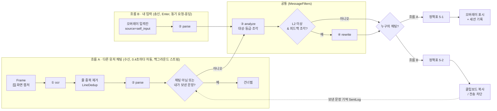
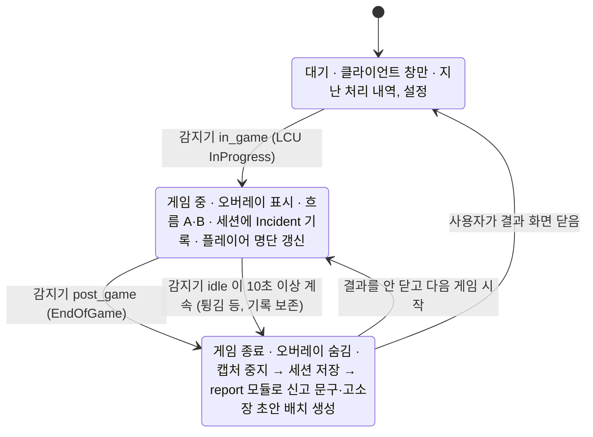

# 아키텍처 (Python + PySide6)

> "어떻게 생겼나"를 설명하는 문서입니다. 모듈별 역할은 `docs/MODULES.md`, 데이터 형식은 `docs/CONTRACTS.md`를 보세요.
> 두 흐름 분리는 ADR-0013, 게임 단계와 세션은 ADR-0014, 모듈 5개 = 함수 5개는 ADR-0017에 결정 이유가 있습니다.

## 1. 한 장 요약

```
┌──────────────────────────── UI 계층 (PySide6, 보여 주기만) ─────────────────────────────┐
│  ClientWindow (대기 / 게임 중 / 이번 게임 결과)      OverlayWindow (게임 중에만, 필터 채팅·입력) │
│        ▲ Qt Signal (EngineBridge)                       │ 내 문장 → OutgoingRunner(작업 스레드) │
└────────┼────────────────────────────────────────────────┼─────────────────────────────────┘
         │ 단계 · Incident · 게임 결과                       │ 흐름 B: submit(text) → Incident
┌────────┴──────────────── 구성 계층 (core, 리드) ───────────┴─────────────────────────────┐
│ Engine: PhaseDetector ─PhaseEvent→ GameStateMachine (IDLE → IN_GAME → POST_GAME → IDLE)   │
│   IN_GAME   : 채팅 소스 ─→ IncomingPipeline(흐름 A) ─→ 세션 기록 + 발행                      │
│   POST_GAME : SessionRepository.save → PostGameBatch(report: kind=report / complaint)       │
│ Pipelines: ModuleSet(함수 5개) · MessageFilters · LineDedup · SentLog · 정책표(core/policy)  │
└──────────────────────────────┬────────────────────────────────────────────────────────────┘
                               │ run(입력 모델) → 출력 모델   (core/modules.py 연결표)
┌──────────────────────────── 모듈 계층 (함수 5개, 5명) ────────────────────────────────────┐
│ ① ocr → ② parse → ③ analyze → ④ rewrite            게임 종료: ⑤ report                     │
│ 각 모듈 = src/clean_chat/modules/<모듈>/impl.py 의 run() 하나 (+ 내부 파일 자유)              │
└──────────────────────────────────────────────────────────────────────────────────────────┘
               ▲ 모든 데이터는 core/schemas.py 의 pydantic 모델 (JSONL 직렬화)
```

## 2. 디자인 패턴

| 위치 | 패턴 | 코드 |
|---|---|---|
| 앱 전체 | **상태 기계(State)** + **이벤트 기반 발행·구독(Observer)** | `core/game.py: GameStateMachine`, `core/engine.py: Engine.subscribe/on_phase/on_result/on_error`, `ui/bridge.py` |
| 흐름 A (수신) | **파이프-필터(Pipes and Filters)** | `core/pipeline.py: IncomingPipeline` |
| 흐름 B (송신) | 같은 처리를 **동기 요청-응답**으로 재사용 | `core/pipeline.py: OutgoingPipeline.submit`, `MessageFilters` |
| 처리 결정 | **표(규칙) 기반 정책** | `core/policy.py: decide_incoming / decide_outgoing` (SPEC 5장) |
| 게임 종료 후 | **배치 처리 + 저장소(Repository)** | `core/game.py: PostGameBatch, SessionRepository`, `session/store.py` |
| 모듈 연결 | **Registry + 의존성 주입** | `core/modules.py: MODULES, ModuleSet` (테스트는 가짜 함수 주입) |
| 입력 소스, 단계 감지기 | **포트와 어댑터(Hexagonal)** | `core/sources.py`(포트), `DemoLineSource`·`ScreenGrabber`·`FakePhaseDetector`·`LcuPhaseDetector`(어댑터) |
| UI | **MVP에 가까운 구조** (화면은 보여 주기만, 판단 없음) | `ui/app.py`(연결), `ui/client.py`, `ui/overlay.py` |

### 두 흐름


### 게임 단계 (상태 기계)

- 표에 없는 전환(예: 대기 중 `post_game`, 같은 단계 반복 보고)은 무시합니다. 전환표: `core/game.py: TRANSITIONS`.
- 감지기는 확인할 때마다 지금 단계를 보냅니다. 게임 중 `idle` 보고는 `settings.idle_grace_sec`(10초) 동안 계속될 때만 게임 종료로 봅니다. 재접속처럼 잠깐 대기로 바뀌어도 게임이 둘로 쪼개지지 않습니다.
- 게임 종료 신호가 오면 **캡처를 먼저 끝내고** 단계를 바꿉니다. 재생 소스(`finite=True`)는 남은 줄을 끝까지 처리해 세션에 넣습니다.
- 신고 문구·고소장을 만드는 동안에는 결과 화면을 닫을 수 없습니다(`Engine.dismiss_result()`가 False). 만들다 실패해도 빈 결과를 보내 화면이 멈추지 않게 합니다.
- 플레이어 명단은 게임 로딩 중에는 비어 있으므로, 받을 때까지 캡처 주기마다 다시 묻습니다.
- 알려진 한계: 공통 처리(analyze·rewrite)는 한 번에 하나씩 돌기 때문에, 흐름 B의 rewrite(LLM, 최대 3초) 동안 흐름 A가 기다립니다.
- **구현 없는 모듈을 만나면 엔진이 멈추고** 그 모듈 이름을 알립니다(`Engine.error`, `on_error`). Mock 으로 대신하지 않습니다(ADR-0017).

## 3. 핵심 패턴: 모듈 = 함수 (ADR-0017)

| 구성 | 파일 | 소유 | 설명 |
|---|---|---|---|
| 모듈 함수 | `modules/<모듈>/impl.py: run` (+ 내부 파일 자유) | 모듈 담당 | `run(입력 모델) -> 출력 모델` 하나 |
| 연결표 | `core/modules.py: MODULES` | 리드 | 이름 → 입력·출력 모델, 함수 위치 |
| 실행 | `core/modules.py: call / invoke`, `ModuleSet` | 리드 | 입력 검증 → 함수 → 출력 검증. `NotImplementedError` → `ModuleNotImplemented` |
| 시뮬레이터 | `uv run sim [모듈]` (`sim/server.py`, `sim/worker.py`) | 리드 | 입력 → 새 프로세스에서 실제 함수 → 디버깅 콘솔(실시간) + 반환값 |

**웹 비유**: 모듈 = 요청·응답 스키마가 고정된 함수(서버리스 함수 하나), fixtures = API 문서의 요청·응답 예시입니다.

### 왜 이 구조인가
- **한 사람 = 한 폴더 = 함수 하나.** 클래스·인터페이스 파일·하위 Stage 가 없어서 무엇을 만들어야 하는지 바로 보입니다.
- **Mock 이 없습니다.** 구현 전에는 어디서 실행해도 "구현 안 됨" 오류가 나서, 동작하는 것처럼 보이는 착각이 없습니다.
- **구현하는 순간 테스트가 켜집니다.** `tests/test_<모듈>.py` 는 구현 전이면 skip, 구현되면 fixtures 로 형식(parse 는 기대값까지)을 검사합니다.
- 연결 구조(흐름·정책표·세션)는 테스트 안의 **가짜 함수**(`tests/helpers.py: fixture_modules`)로 따로 검증합니다.

## 4. 실행 모드와 OS (ADR-0012)

| 명령 | 채팅 소스 | 단계 감지기 | Mac | Windows | 용도 |
|---|---|---|---|---|---|
| `uv run sim [모듈]` | 화면에서 입력 | – | ✅ | ✅ | 모듈 하나 실행: 입력 / 디버깅 콘솔 / 반환값 |
| `python -m clean_chat.session` | – | 가짜 | ✅ | ✅ | 단계 이벤트 확인 (`--real`은 🪟) |
| `uv run app` (Mac 등) | 시나리오 재생 | 가짜 | ✅ | – | 앱 전체 (게임 없이, 모듈 5개 구현 후 끝까지) |
| `uv run app` (Windows) | 실제 화면 캡처 | LCU | – | ✅ | **실제 데모** |

- Windows 전용 코드는 3곳입니다: `core/grabber.py`(화면 캡처), `ui/win32.py`(오버레이 캡처 제외), `session/windows.py`(LCU 단계 감지). 모두 `core/platform.py`의 `require_windows()` / `IS_WINDOWS`로 막습니다.
- Windows 전용 라이브러리는 **함수 안에서 import**하고, `pyproject.toml`에 `; sys_platform == 'win32'` 마커를 붙입니다. 그래야 Mac에서 `uv sync`가 깨지지 않습니다.
- CI는 **macOS와 Windows 두 곳**에서 설치, 린트, 테스트, 시뮬레이터 모듈 목록을 확인합니다.

## 5. 스레드 구조 (데스크톱 앱 초보자용)
```
메인 스레드 (Qt 이벤트 루프)  ── 화면 그리기, 버튼 클릭          ← 여기서 오래 걸리는 일 금지 (앱이 멈춤)
엔진 스레드 (Engine)         ── 단계 감지기 이벤트 → 상태 기계, 게임 종료 배치 처리
캡처 스레드 (게임 중에만)      ── 캡처 → ocr → parse → analyze → rewrite → 정책표
작업 스레드 (QThreadPool)     ── 흐름 B: parse → analyze → rewrite → 정책표 (rewrite LLM 최대 3초)
          └─ 결과 → EngineBridge / OutgoingRunner Signal → 메인 스레드에서 화면 갱신
```
- 공통 처리(`MessageFilters`)는 흐름 A와 B가 동시에 부를 수 있어서 잠금으로 한 번에 하나씩 실행합니다.
- 흐름 B는 호출 방식이 "요청 1개 → 결과 1개"(동기)이고, 실행만 작업 스레드에서 합니다.

## 6. 폴더 구조
```
src/clean_chat/
├─ __main__.py         실행 명령 2개: sim / app
├─ modules/            모듈 5개 = 5명 (각 폴더: impl.py 의 run() + README.md + 내부 파일 자유)
│  ├─ ocr/               ① 이미지 → 줄
│  ├─ parse/             ② 줄 → 채팅만 + 정규화
│  ├─ analyze/           ③ 대상·등급·피드백
│  ├─ rewrite/           ④ 순화
│  └─ report/            ⑤ 신고·고소장
├─ core/               구성 (리드)
│  ├─ schemas.py         통신 포맷 (모든 모델)
│  ├─ modules.py         모듈 연결표, 실행(검증), ModuleSet
│  ├─ pipeline.py        MessageFilters, LineDedup, SentLog, IncomingPipeline, OutgoingPipeline (판단 로직 없음)
│  ├─ policy.py          정책표 (SPEC 5-1, 5-2)
│  ├─ game.py            GameStateMachine, SessionRepository, PostGameBatch
│  ├─ engine.py          백그라운드 실행 + 구독 (단계 → 캡처 → 결과)
│  ├─ sources.py         입력 포트 (채팅 소스, 단계 감지기) + demo / screenshots 어댑터
│  ├─ grabber.py         🪟 화면 캡처 → Frame
│  ├─ jsonl.py           JSONL 입출력
│  ├─ platform.py        OS 구분, 콘솔 UTF-8
│  └─ config.py          설정
├─ sim/      server.py worker.py inputs.py static/   로컬 모듈 시뮬레이터 (리드)
├─ session/  fake.py windows.py(🪟) store.py   구성 (리드)
└─ ui/       app.py bridge.py client.py overlay.py win32.py(🪟)  구성 (리드)
fixtures/<모듈>/input.jsonl, expected.jsonl     모듈별 입출력 예시 = 명세 (두 앱 공통)
fixtures/scenario/                              전체 흐름 입력 (lines, outgoing, phases, players)
```
- 시뮬레이터(`sim/`)는 로컬 전용이고 배포하지 않습니다. 파이썬 서버가 HTML 화면(`sim/static/`, 빌드 없음)도 함께 줍니다(ADR-0019).

## 7. 모듈 안에서 자유롭게 해도 되는 것
- `impl.py` 의 `_도우미()` 함수를 바꾸거나 지우기, 같은 폴더에 내부 파일 추가 (예: `analyze/model.py`, `rewrite/prompts.py`, `report/templates/`)
- 내부 클래스, 설정, 캐시(`functools.cache`)
- `fixtures/<내 모듈>/input.jsonl`에 입력 사례 추가 (`expected`는 리드 리뷰)

## 8. 하면 안 되는 것
- `run()` 이름과 입력·출력 모델 변경 (→ 계약 변경 이슈)
- 다른 모듈 폴더를 직접 import (→ 연결은 구성이 함)
- 모듈 안에서 숨김·신고 같은 처리 결정 (→ 정책표 `core/policy.py`)
- UI에서 분류나 정책 판단
- `core/game.py`의 상태 전환표를 모듈에서 바꾸기 (→ 리드)
