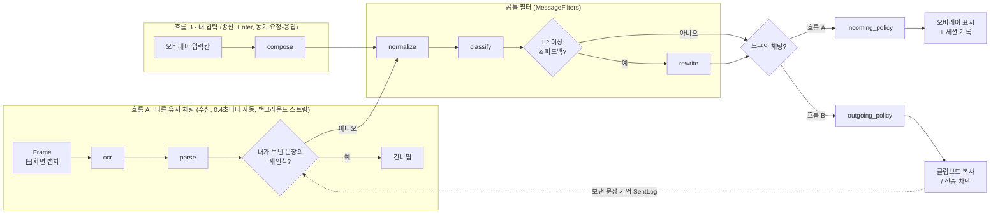
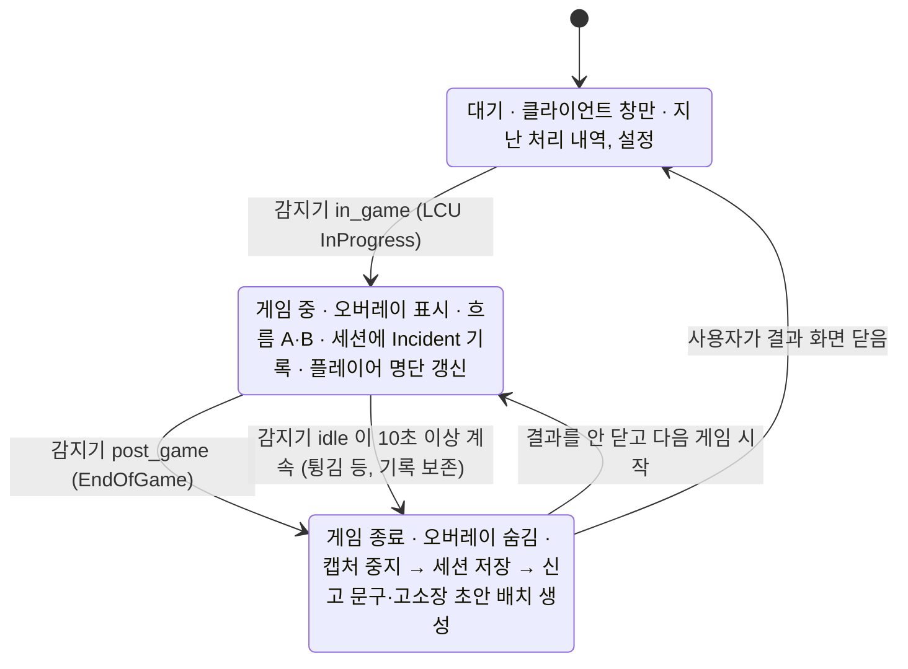

# 아키텍처 (Python + PySide6)

> "어떻게 생겼나"를 설명하는 문서입니다. 모듈별 역할은 `docs/MODULES.md`, 데이터 형식은 `docs/CONTRACTS.md`를 보세요.
> 두 흐름 분리는 ADR-0013, 게임 단계와 세션은 ADR-0014에 결정 이유가 있습니다.

## 1. 한 장 요약

```
┌──────────────────────────── UI 계층 (PySide6, 보여 주기만) ─────────────────────────────┐
│  ClientWindow (대기 / 게임 중 / 이번 게임 결과)      OverlayWindow (게임 중에만, 필터 채팅·입력) │
│        ▲ Qt Signal (EngineBridge)                       │ 내 문장 → OutgoingRunner(작업 스레드) │
└────────┼────────────────────────────────────────────────┼─────────────────────────────────┘
         │ 단계 · Incident · 게임 결과                       │ 흐름 B: submit(text) → Incident
┌────────┴──────────────── 실행 계층 (core) ─────────────────┴─────────────────────────────┐
│ Engine: PhaseDetector ─PhaseEvent→ GameStateMachine (IDLE → IN_GAME → POST_GAME → IDLE)   │
│   IN_GAME   : 채팅 소스 ─→ IncomingPipeline(흐름 A) ─→ 세션 기록 + 발행                      │
│   POST_GAME : SessionRepository.save → PostGameBatch(report / complaint) → 결과 발행        │
│ Pipelines: StageSet(모든 Stage, real/mock) · MessageFilters(공통 필터) · SentLog(내 문장 기억)  │
└──────────────────────────────┬────────────────────────────────────────────────────────────┘
                               │ Stage.run(입력 모델) → 출력 모델
┌──────────────────────────── 처리 계층 (Stage 10개) ─────────────────────────────────────┐
│ 흐름 A: ocr → parse ─┐                       ┌→ incoming_policy                            │
│                     ├→ normalize → classify → [rewrite] ┤                                 │
│ 흐름 B: compose ─────┘                       └→ outgoing_policy      게임 종료: report, complaint │
│  각 Stage = stage.py(인터페이스) + impl.py(실제) + MockStage(fixtures 응답)                 │
└──────────────────────────────────────────────────────────────────────────────────────────┘
               ▲ 모든 데이터는 core/schemas.py 의 pydantic 모델 (JSONL 직렬화)
```

## 2. 디자인 패턴

| 위치 | 패턴 | 코드 |
|---|---|---|
| 앱 전체 | **상태 기계(State)** + **이벤트 기반 발행·구독(Observer)** | `core/game.py: GameStateMachine`, `core/engine.py: Engine.subscribe/on_phase/on_result`, `ui/bridge.py` |
| 흐름 A (수신) | **파이프-필터(Pipes and Filters)** | `core/pipeline.py: IncomingPipeline` |
| 흐름 B (송신) | 같은 필터를 **동기 요청-응답**으로 재사용 | `core/pipeline.py: OutgoingPipeline.submit`, `MessageFilters` |
| 게임 종료 후 | **배치 처리 + 저장소(Repository)** | `core/game.py: PostGameBatch, SessionRepository`, `session/store.py` |
| real/mock, LLM 백엔드, OCR 엔진 | **Strategy + Registry(Factory)** | `core/registry.py`, `core/pipeline.py: StageSet`, `rewrite/impl.py: LlmBackend`, `capture/impl.py: OcrBackend` |
| 입력 소스, 단계 감지기 | **포트와 어댑터(Hexagonal)** | `core/sources.py`(포트), `DemoLineSource`·`ScreenGrabber`·`FakePhaseDetector`·`LcuPhaseDetector`(어댑터) |
| UI | **MVP에 가까운 구조** (화면은 보여 주기만, 판단 없음) | `ui/app.py`(연결), `ui/client.py`, `ui/overlay.py` |

### 두 흐름


### 게임 단계 (상태 기계)

- 표에 없는 전환(예: 대기 중 `post_game`, 같은 단계 반복 보고)은 무시합니다. 전환표: `core/game.py: TRANSITIONS`.
- 감지기는 확인할 때마다 지금 단계를 보냅니다. 게임 중 `idle` 보고는 `settings.idle_grace_sec`(10초) 동안 계속될 때만 게임 종료로 봅니다. 재접속처럼 잠깐 대기로 바뀌어도 게임이 둘로 쪼개지지 않습니다.
- 게임 종료 신호가 오면 **캡처를 먼저 끝내고** 단계를 바꿉니다. 재생 소스(`finite=True`)는 남은 줄을 끝까지 처리해 세션에 넣습니다.
- 신고 문구·고소장을 만드는 동안에는 결과 화면을 닫을 수 없습니다(`Engine.dismiss_result()`가 False). 만들다 실패해도 빈 결과를 보내 화면이 멈추지 않게 합니다.
- 플레이어 명단은 게임 로딩 중에는 비어 있으므로, 받을 때까지 캡처 주기마다 다시 묻습니다.
- 알려진 한계: 공통 필터는 한 번에 하나씩 돌기 때문에, 흐름 B의 rewrite(LLM, 최대 3초) 동안 흐름 A가 기다립니다.

## 3. 핵심 패턴: Stage

| 구성 | 파일 | 소유 | 설명 |
|---|---|---|---|
| 인터페이스 | `<모듈>/stage.py` | 리드 | `name`, `input_model`, `output_model`, `mock_default()` |
| 실제 구현 | `<모듈>/impl.py` (+ 내부 파일 자유) | 모듈 담당 | `setup()`, `run(입력) -> 출력`, `close()` |
| 가짜 구현 | `core/stage.py: MockStage` | 자동 | `fixtures/<name>/input.jsonl` → `expected.jsonl` 그대로 응답 |
| 단독 실행 | `<모듈>/__main__.py` | 자동 | `python -m clean_chat.<모듈> [하위 Stage]` |
| 등록 | `core/registry.py`, `core/config.py: STAGE_NAMES, STAGE_COMMANDS` | 리드 | 이름 → 인터페이스·구현 연결 |

한 모듈 폴더에 Stage가 여러 개인 곳: `text/`(parse, compose, normalize — 파일 하나에 클래스 하나, ADR-0016), `policy/`(incoming_policy, outgoing_policy), `report/`(report, complaint).

**웹 비유**: Stage = 요청·응답 스키마가 고정된 API 엔드포인트, MockStage = MSW 같은 목 서버, fixtures = API 문서의 요청·응답 예시입니다.

### 왜 이 구조인가 (ADR-0011)
- **모듈마다 real과 mock을 골라 끼울 수 있습니다.** `clean-chat run --real parse` → parse만 실제, 나머지는 mock.
- **구현하는 순간 테스트가 켜집니다.** `tests/test_real_impls.py`는 `NotImplementedError`이면 skip하고, 구현되면 자동으로 형식과 기대값을 검사합니다.
- fixtures의 `expected.jsonl`이 곧 **명세**입니다. mock은 입력 JSON이 **글자 하나까지 같을 때만** fixtures 응답을 돌려주고, 아니면 `mock_default()`(형식만 맞는 값)를 돌려줍니다.

## 4. 실행 모드와 OS (ADR-0012)

| 명령 | 채팅 소스 | 단계 감지기 | Mac | Windows | 용도 |
|---|---|---|---|---|---|
| `python -m clean_chat.<모듈>` | fixtures | – | ✅ | ✅ | 모듈 단독 개발·테스트 |
| `python -m clean_chat.session` | – | 가짜 | ✅ | ✅ | 단계 이벤트 확인 (`--real`은 🪟) |
| `clean-chat run --source demo` | 시나리오 JSONL | 가짜 | ✅ | ✅ | 단계 전환 + 흐름 A + 게임 결과를 콘솔로 |
| `clean-chat say "<문장>"` | – | – | ✅ | ✅ | 흐름 B 1문장 |
| `clean-chat run --source screenshots` | PNG 폴더 | 가짜 | ✅ | ✅ | OCR 포함 흐름 확인 |
| `clean-chat app --source demo` | 시나리오 | 가짜 | ✅ | ✅ | UI 개발 (게임 없이) |
| `clean-chat app --source screen` | 실제 화면 캡처 | LCU | ❌ | ✅ | **실제 데모** |

- Windows 전용 코드는 3곳입니다: `capture/grabber.py`(화면 캡처), `ui/win32.py`(오버레이 캡처 제외), `session/windows.py`(LCU 단계 감지). 모두 `core/platform.py`의 `require_windows()` / `IS_WINDOWS`로 막습니다.
- Windows 전용 라이브러리는 **함수 안에서 import**하고, `pyproject.toml`에 `; sys_platform == 'win32'` 마커를 붙입니다. 그래야 Mac에서 `uv sync`가 깨지지 않습니다.
- CI는 **macOS와 Windows 두 곳**에서 설치, 린트, 테스트, 모든 Stage 단독 실행, `say`를 돌립니다.

## 5. 스레드 구조 (데스크톱 앱 초보자용)
```
메인 스레드 (Qt 이벤트 루프)  ── 화면 그리기, 버튼 클릭          ← 여기서 오래 걸리는 일 금지 (앱이 멈춤)
엔진 스레드 (Engine)         ── 단계 감지기 이벤트 → 상태 기계, 게임 종료 배치 처리
캡처 스레드 (게임 중에만)      ── 캡처 → OCR → 공통 필터 → incoming_policy
작업 스레드 (QThreadPool)     ── 흐름 B: compose → 공통 필터 → outgoing_policy (rewrite LLM 최대 3초)
          └─ 결과 → EngineBridge / OutgoingRunner Signal → 메인 스레드에서 화면 갱신
```
- 공통 필터(`MessageFilters`)는 흐름 A와 B가 동시에 부를 수 있어서 잠금으로 한 번에 하나씩 실행합니다.
- 흐름 B는 호출 방식이 "요청 1개 → 결과 1개"(동기)이고, 실행만 작업 스레드에서 합니다.

## 6. 폴더 구조
```
src/clean_chat/
├─ __main__.py         CLI (run / say / app / modules)
├─ core/               [WP1] 계약·실행 기반
│  ├─ schemas.py         통신 포맷 (모든 모델)
│  ├─ stage.py           Stage 틀, MockStage, JSONL 입출력
│  ├─ registry.py        Stage 등록표
│  ├─ pipeline.py        StageSet, MessageFilters, SentLog, IncomingPipeline, OutgoingPipeline (판단 로직 없음)
│  ├─ game.py            GameStateMachine, SessionRepository, PostGameBatch
│  ├─ engine.py          백그라운드 실행 + 구독 (단계 → 캡처 → 결과)
│  ├─ sources.py         입력 포트 (채팅 소스, 단계 감지기) + demo / screenshots 어댑터
│  ├─ runner.py          모듈 단독 실행기
│  ├─ platform.py        OS 구분, 콘솔 UTF-8
│  └─ config.py          설정 (모듈별 real/mock 포함)
├─ capture/  stage.py impl.py(OCR) grabber.py(🪟)          [WP2]
├─ text/     stage.py parse.py compose.py normalize.py     [WP3]
├─ classify/ stage.py impl.py                              [WP4]
├─ rewrite/  stage.py impl.py                              [WP5]
├─ policy/   stage.py impl.py (incoming + outgoing)        [WP1]
├─ report/   stage.py impl.py (report + complaint)         [WP6]
├─ session/  fake.py windows.py(🪟) store.py               [WP8]
└─ ui/       app.py bridge.py client.py overlay.py win32.py(🪟)  [WP7]
fixtures/<stage>/input.jsonl, expected.jsonl    모듈별 통신 예시 = 명세 (두 앱 공통)
fixtures/scenario/                              전체 흐름 예시 (lines, outgoing, phases, players, expected_*)
contracts/stages.schema.json                    공통 계약: schemas.py → JSON Schema (자동 생성, 두 앱 공통)
simulator/                                      웹 시뮬레이터 (Next.js, Vercel 배포) — simulator/README.md
```
- 데스크톱 앱과 웹 시뮬레이터는 같은 레포의 **별도 앱**입니다. 코드를 공유하지 않고 `contracts/`(계약)와 `fixtures/`(데이터)만 공유합니다(ADR-0015).

## 7. 모듈 안에서 자유롭게 해도 되는 것
- `impl.py`에서 내부 파일 추가 (예: `classify/model.py`, `rewrite/backends/api.py`, `report/templates/`)
- 내부 클래스, 설정, 캐시
- `fixtures/<내 stage>/`에 입력 사례 추가 (`expected`는 리드 리뷰)

## 8. 하면 안 되는 것
- `stage.py`의 입력·출력 모델 변경 (→ 계약 변경 이슈)
- 다른 모듈의 `impl.py`를 직접 import (→ 반드시 Pipeline이나 Stage를 거침)
- UI에서 분류나 정책 판단
- `core/game.py`의 상태 전환표를 모듈에서 바꾸기 (→ 리드)
